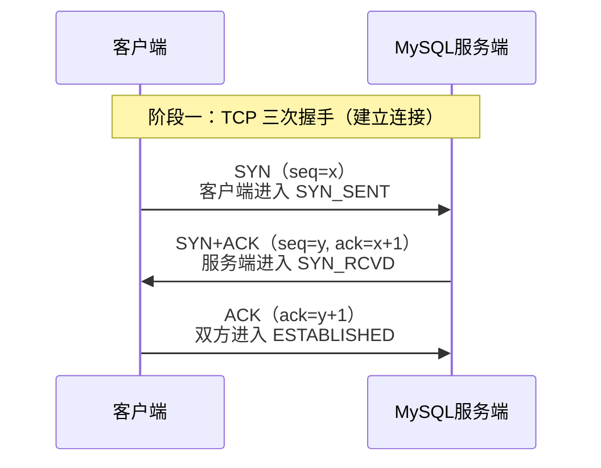
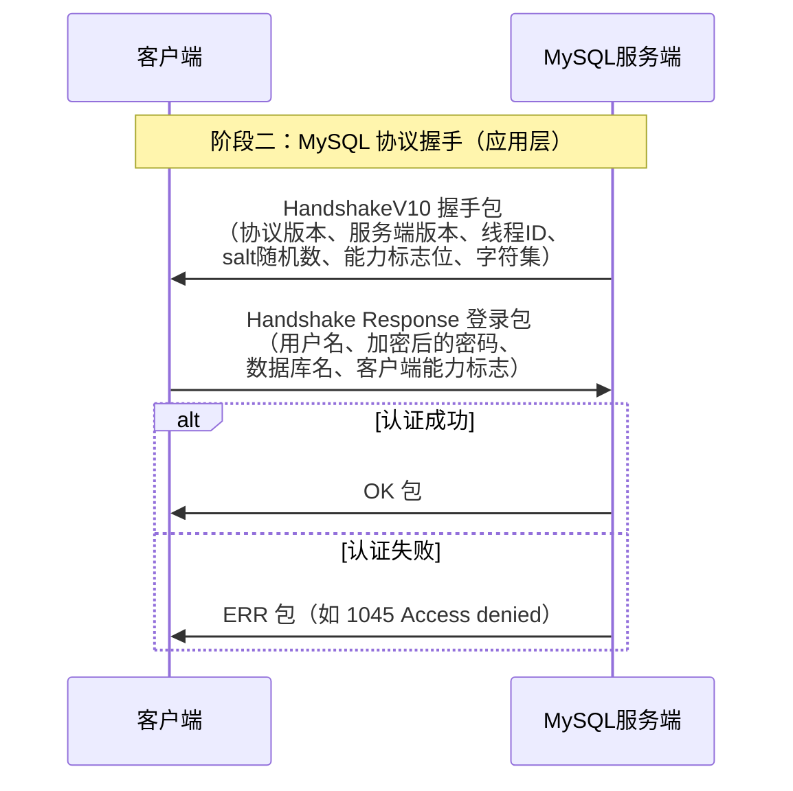
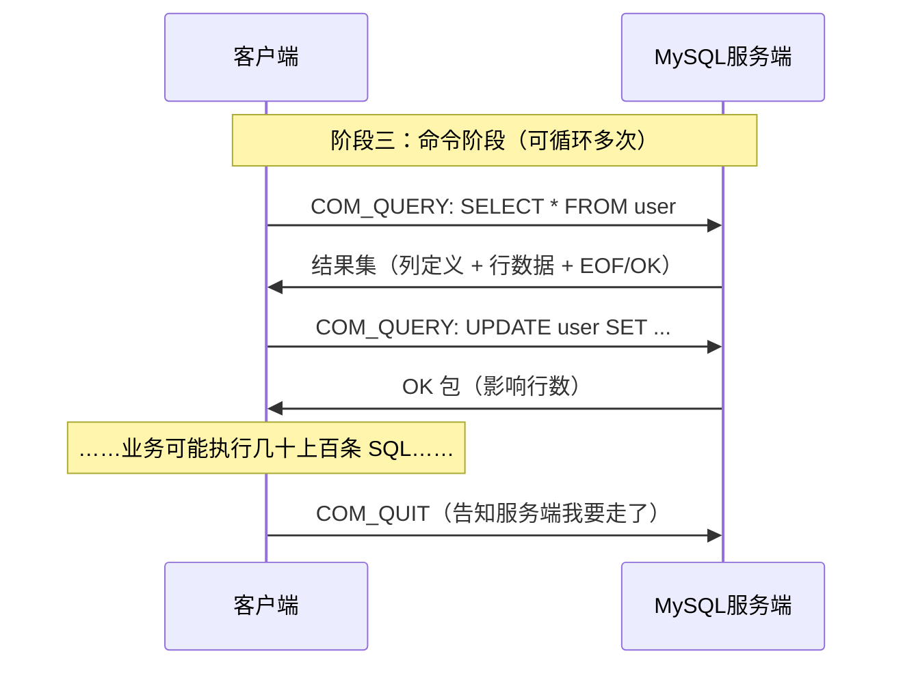
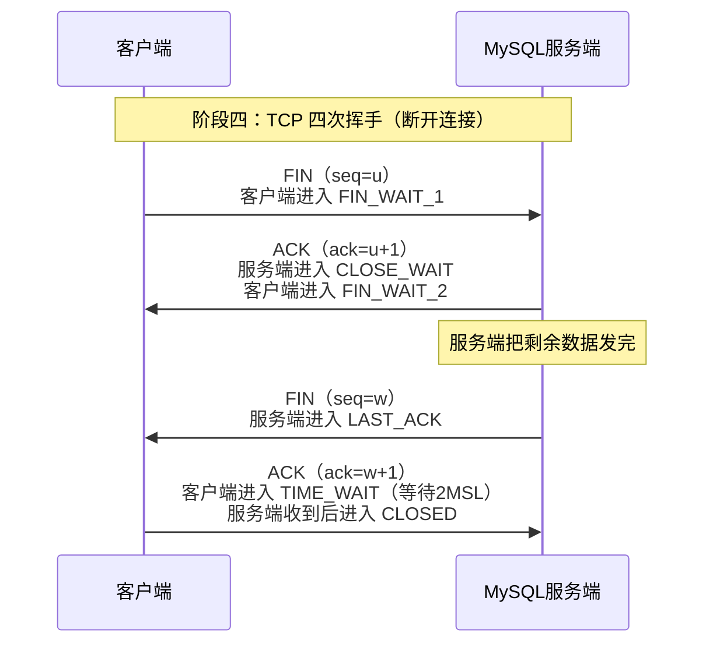
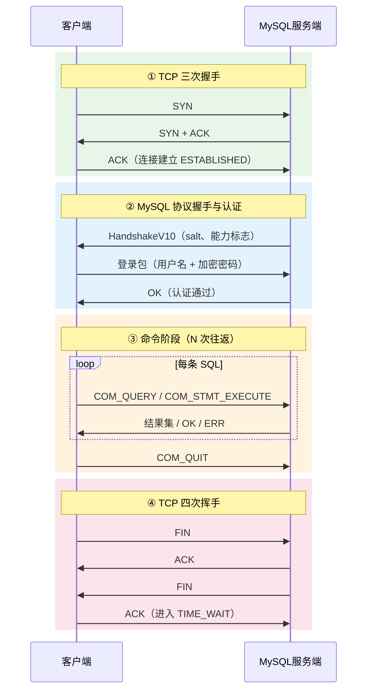

# MySQL连接池

## 理论部分

### 什么是数据库连接池？

数据库连接池（Database Connection Pool）是一种**在应用启动时预先创建一批数据库连接、并在运行期复用这些连接**的资源管理技术。

它的核心结构通常包含：

- **连接集合（Pool）**：存放若干已经建立好的、处于空闲状态的数据库连接，一般分「空闲连接」和「活跃（使用中）连接」两个队列。
- **借出 / 归还接口**：业务线程通过 `getConnection()` 从池中"借"一个连接，用完后通过 `close()`（实际是归还而非真正关闭）把连接还给池子。
- **管理机制**：负责连接的创建、校验（心跳/保活）、超时回收、泄漏检测、动态扩缩容等。

可以把连接池类比为"共享单车"：车（连接）不是每个人都买一辆，而是集中投放一批，谁用谁取，用完归还，供下一个人继续使用。

### 数据库连接池解决了什么问题？

如果不用连接池，每次执行 SQL 都要走「建立 TCP 连接 → MySQL 协议握手与认证 → 执行 SQL → 断开连接」的完整流程，会带来以下问题：

1. **连接建立/销毁开销巨大**
   - 每次建立连接都要经过 TCP 三次握手、MySQL 服务端线程分配、SSL 协商（如开启）、用户认证（可能涉及多次网络往返）。
   - 一次完整建连通常需要 **几毫秒到几十毫秒**，而一条简单 SQL 的执行可能不到 1 毫秒——连接开销远远超过业务本身。
   - 高并发下频繁的 TCP 建断还会产生大量 `TIME_WAIT` 状态的套接字，耗尽端口资源。

2. **数据库服务端资源被无限制占用**
   - MySQL 每个连接在服务端都对应一个线程和一块内存（线程栈、sort buffer、join buffer 等），`max_connections` 是有限的。
   - 如果没有池子做上限控制，突发流量会瞬间打满数据库连接数，导致新请求直接被拒绝（`Too many connections`），甚至拖垮整个数据库。

3. **并发访问下缺乏统一调度**
   - 没有池子时，每个业务线程各自为政地建连，无法对连接数、等待时间、连接健康状态做统一管理。
   - 连接池充当了应用与数据库之间的"闸门"：最多只放 N 个并发请求到数据库，多余的请求排队等待，保护数据库不被打垮。

4. **连接状态不可控**
   - 网络闪断、MySQL 服务端 `wait_timeout` 主动断开空闲连接等情况，会让应用手里的"死连接"在使用时才报错。连接池通过心跳检测、连接校验机制可以剔除无效连接。

**一句话总结**：连接池解决的是「连接创建昂贵、连接数量需要受控、连接状态需要统一管理」三大问题。

### 怎么解决的？

连接池通过以下机制解决上述问题：

1. **连接复用（池化）**
   - 启动时预先创建一批连接（`initialSize` / `minIdle`），请求来了直接拿现成连接用，跳过 TCP 握手和认证过程，用完后归还而不是关闭，从而把「建连成本」摊薄到几乎为零。

2. **数量控制与排队等待**
   - 通过 `maxActive`（最大连接数）限制并发上限；连接耗尽时，新的获取请求会阻塞等待（`maxWait` 超时时间），而不是直接打到数据库，起到削峰填谷、保护数据库的作用。
   - 池子本质上是"有界资源 + 等待队列"的模型，常用阻塞队列 + 锁/信号量实现。

3. **连接健康维护**
   - **有效性校验**：借出前执行轻量探测（如 MySQL 的 `ping` / `SELECT 1`，对应 Druid 的 `testOnBorrow`、HikariCP 的 `keepalive`）。
   - **空闲超时与保活**：空闲太久的连接主动销毁，避免被服务端 `wait_timeout` 单方面断开后成为"僵尸连接"；HikariCP 还会周期性发送 keepalive 防止被中间网络设备断连。
   - **泄漏检测**：借出后长时间未归还的连接（如超过 `removeAbandonedTimeout`）强制回收并告警，防止代码忘记 `close()` 导致连接泄漏。

4. **动态伸缩**
   - 高峰期按需创建新连接直到上限，低谷期回收多余空闲连接，在「响应速度」和「资源占用」之间取得平衡。

5. **典型实现**
   - Java 生态：Druid、HikariCP、DBCP2、C3P0；
   - Go：`database/sql` 内置连接池；
   - C++ 等语言通常需要自己基于线程安全的队列实现（借出加锁、条件变量等待），这也是手写连接池的经典面试/练手项目。

#### 同步连接和异步连接的区别

这里的"同步/异步"指的是**应用线程与数据库交互时的等待方式**：

| 维度 | 同步连接 | 异步连接 |
|------|----------|----------|
| 调用方式 | 线程发出 SQL 后**阻塞等待**结果返回 | 线程发出 SQL 后**立即返回**，结果通过回调 / Future / 事件通知 |
| 线程占用 | 一个并发请求全程占用一个线程 | 少量线程（事件循环）可承载大量并发请求 |
| 编程模型 | 简单直观，代码顺序执行 | 复杂，需要处理回调或 Future/Promise 链 |
| 典型实现 | JDBC、`mysqlclient`、Go `database/sql`（对使用者表现为同步） | 基于 NIO/IOCP 的驱动、Vert.x MySQL Client、mysqlx/异步封装的驱动 |
| 适用场景 | 常规业务、请求量可预测 | 高并发 I/O 密集型、网关、实时推送等 |

关键点：**同步阻塞的不是"CPU"，而是线程**。线程阻塞等待数据库返回期间不消耗 CPU，但占着内存（线程栈）且无法处理其他任务，因此并发能力受线程数限制；异步模型用事件驱动把线程从等待中解放出来，用少量线程支撑海量并发，代价是编程复杂度上升。

#### 什么是同步连接池

同步连接池是最常见的一类连接池：**池子里管理的是同步（阻塞式）连接**。

- 业务线程调用 `getConnection()` 获取连接后，用该连接执行 SQL 时**线程会阻塞**，直到数据库返回结果；
- 一个连接同一时刻只能服务一个请求，因此**池的大小直接决定了能同时打向数据库的并发请求数**；
- 实现上通常是：空闲连接放在阻塞队列里，借出时 `take()`（无连接可用则阻塞等待或超时），归还时 `put()` 回去；
- 典型代表：Java 的 **HikariCP、Druid、DBCP2**，Go 的 `database/sql`（内部有池，但对外接口是同步的）。

同步连接池的优点是简单可靠、与业务代码天然契合，是绝大多数 CRUD 类应用的标准选择。

#### 什么是异步连接池

异步连接池管理的是**异步（非阻塞）连接**：

- 连接执行 SQL 时**不阻塞调用线程**，而是注册回调或返回 Future，等数据库响应到达后由事件循环线程触发后续逻辑；
- 一个异步连接在底层往往通过**多路复用**（一个 TCP 连接上流水线式地跑多个请求，或绑定在少量 I/O 线程上）支撑远高于同步模型的并发；
- "池"在这里的语义也略有变化：除了复用连接，更重要的是**管理事件循环资源、限制并发请求数、背压（backpressure）控制**；
- 典型代表：**Vert.x Reactive MySQL Client**（基于 Netty 事件循环）、R2DBC 风格的响应式驱动、Node.js 生态的各类异步连接池。

一句话对比：**同步连接池"以连接数换并发"，异步连接池"以事件驱动换并发"**——前者靠堆连接和线程，后者靠少量线程 + 非阻塞 I/O。

### 单条 MySQL 连接交互过程（三次握手与四次挥手完整交互图）

> 说明：TCP 建立连接是**三次握手（Three-way Handshake）**，断开连接是**四次挥手（Four-way Wavehand）**。

一条 MySQL 连接从建立到销毁，完整经历以下四个阶段：

```
阶段一：TCP 三次握手（建立传输层连接）
阶段二：MySQL 协议握手与认证（应用层握手：能力协商 + 用户认证）
阶段三：命令阶段（真正的 SQL 交互，可往返多次）
阶段四：TCP 四次挥手（释放连接）
```

#### 阶段一：TCP 三次握手



- **第一次握手**：客户端发送 SYN 报文（随机初始序列号 x），进入 `SYN_SENT` 状态。
- **第二次握手**：服务端回复 SYN+ACK（自己的序列号 y，并确认收到 x），进入 `SYN_RCVD` 状态。
- **第三次握手**：客户端回复 ACK，双方进入 `ESTABLISHED`，连接建立。
- **为什么是三次而不是两次**：第三次握手是为了让服务端确认"客户端确实能收到我的回复"，防止历史失效的连接请求突然到达服务端导致资源浪费。

#### 阶段二：MySQL 协议握手与认证

TCP 连接建立后，MySQL 还有一层**应用层握手**，这是 MySQL 协议特有的：



要点：

- **服务端先开口**：与直觉相反，TCP 建连后是服务端**主动**发送握手包（HandshakeV10），告知自己的能力并下发用于密码加密的随机数（salt）。
- **密码不裸传**：客户端用 salt 对密码做哈希（如 `mysql_native_password` 是 `SHA1(SHA1(password))` 再与 salt 混合哈希），若开启 SSL 则整个认证过程加密。
- **认证通过后**，连接进入"命令阶段"，可以开始执行 SQL。

#### 阶段三：命令阶段（SQL 交互）

认证成功后，客户端与服务端进入「一问一答」的命令循环，可以执行任意多条 SQL：



- 常见命令：`COM_QUERY`（普通 SQL）、`COM_STMT_PREPARE` / `COM_STMT_EXECUTE`（预编译语句）、`COM_PING`（心跳探测，连接池常用它做有效性校验）等。
- 这一阶段可以**持续很久、往返很多次**——连接池的价值就在于让这个阶段反复发生，而不用每次都重走阶段一、二。
- 结束时客户端通常发送 `COM_QUIT` 礼貌告知，随后进入 TCP 断开流程。

#### 阶段四：TCP 四次挥手



- **为什么是四次而不是三次**：TCP 是全双工的，两个方向的数据流要分别关闭。客户端发 FIN 只表示"我不再发数据了"，但服务端可能还有数据没发完，所以服务端的 ACK 和 FIN 无法像握手时那样合并成一次，必须分两次发送，于是多出一拍。
- **TIME_WAIT**：主动关闭方（通常是客户端）在发出最后一个 ACK 后要等待 2MSL（报文最大生存时间的 2 倍），确保 ACK 能被对方收到（若丢失可重传），并让本次连接的旧报文在网络上彻底消失，避免污染新连接。
- **高并发短连接的危害**：如果不用连接池、每条 SQL 都建断一次连接，大量 TIME_WAIT 会堆积在客户端机器上，耗尽本地端口（默认 2 万多个可用端口）——这正是连接池要消灭的场景。

#### 全链路总览



**与连接池的关系**：连接池做的事，就是把 ①②④ 这些昂贵且重复的步骤**只做一次**，让连接长期停留在阶段 ③ 被反复复用；同时用 `COM_PING` 之类的心跳维持连接活性，用数量上限保护数据库。

### MySQL  C/C++ 驱动需要实现哪些内容？

必须 实现 MySQL 协议

1. **connect**
2. **read/recv**
3. **write/send**
4. **read/recv**

### 连接数一般取多少个？

2 * CPU 核心数。
